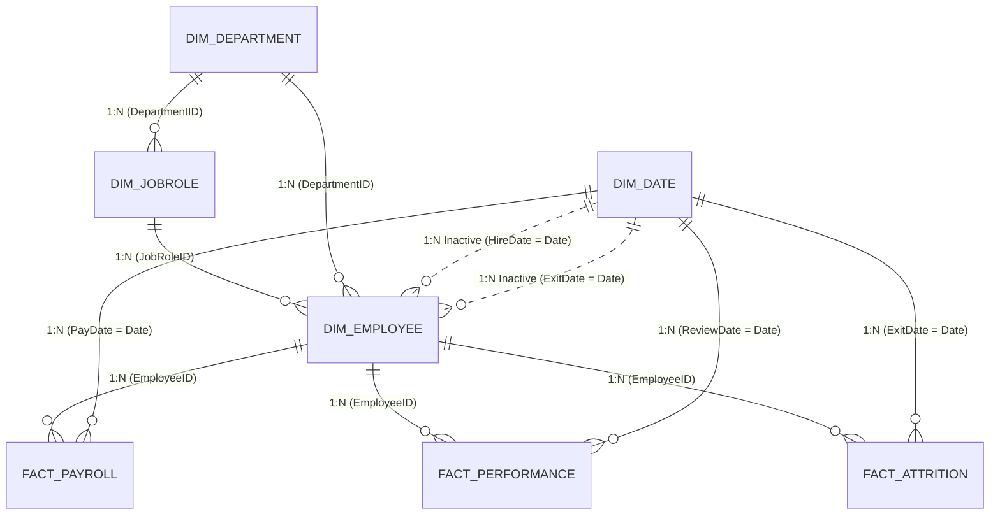

# PulseHR | Premium Minimal SaaS & Power BI Project Suite

An enterprise-grade, end-to-end **HR & People Analytics Solution** designed to monitor executive workforce metrics, diagnose voluntary & involuntary attrition, audit compensation equity, and manage talent using a 9-box succession grid.

Redesigned with a **premium, minimal SaaS analytics aesthetic**:
- **Zero Emojis**: Replaced with clean, lightweight Lucide-style outline SVG icons.
- **Warm Neutral Shell**: Centered 26px rounded white application container on `#F1F1F1` background.
- **Card-based Grid**: Consistent 4px spacing scale, subtle `#F0F0F3` borders, and minimal diffuse shadows.
- **Selective Pastel Palette**: Lavender (`#C9B8F5`), Pale Green (`#DCEFBF`), Pale Blue (`#DDEBFF`), Pale Rose (`#F8DCE4`), and Pale Yellow (`#F7E8B4`).
- **5-Column KPI Row**: High-density executive scorecard with comparison indicators.
- **Interactive Two-Column Dashboard Grid**: 62% / 38% split with minimal Chart.js charts.


---

## 📁 Project Directory Structure

All project deliverables are stored in:
`C:\Users\Himabala\.gemini\antigravity-ide\scratch\hr_analytics_powerbi\`

```text
hr_analytics_powerbi/
├── HR_Analytics.pbip               <-- Open directly in Power BI Desktop
├── HR_Analytics.Report/
│   └── definition.pbir             <-- Report definition link
├── HR_Analytics.SemanticModel/
│   ├── definition.pbism            <-- Semantic model definition
│   └── model.bim                   <-- Tabular Object Model (Tables, Measures, Relationships)
│
├── data/                           <-- Clean Star Schema CSV Dataset
│   ├── Dim_Department.csv          (7 departments with divisions, cost centers, leadership)
│   ├── Dim_JobRole.csv             (29 job titles, salary bands, pay grades)
│   ├── Dim_Date.csv                (2,557 daily records from 2020 to 2026, fiscal calendars)
│   ├── Dim_Employee.csv            (1,250 employee profiles with demographic attributes)
│   ├── Fact_Attrition.csv          (204 separation events with reasons and turnover costs)
│   ├── Fact_Performance.csv        (3,534 annual reviews with 9-box grids, training, ratings)
│   └── Fact_Payroll.csv            (13,066 quarterly compensation & overtime records)
│
├── DAX_Measures_Library.dax        <-- 35+ Production-grade DAX measures ready to paste
├── DAX_Measures_Reference.md       <-- KPI dictionary, formulas, and visual recommendations
├── power_query_scripts.m           <-- Complete Power Query M code for automated ETL
├── data_model_schema.md            <-- Mermaid ER diagram, relationship cardinality, and keys
├── dashboard_design_specs.md       <-- Page-by-page visual layout, chart types, and colors
│
├── generate_dataset.py             <-- Script to regenerate synthetic data if needed
├── build_pbip.py                   <-- Script that constructed the PBIP model
├── index.html                      <-- Interactive web dashboard application
├── index.css                       <-- Executive modern styling & theme engine
├── app.js                          <-- Real-time DAX calculation & chart cross-filtering
└── app_data.js                     <-- Pre-packaged relational data payload
```

---

## 🖥️ How to Open in Power BI Desktop

### Method 1: Direct PBIP Launch (Fastest)
1. Open Windows File Explorer and navigate to:
   `C:\Users\Himabala\.gemini\antigravity-ide\scratch\hr_analytics_powerbi\`
2. Double-click **`HR_Analytics.pbip`**.
3. Power BI Desktop will launch with the **HR_Analytics_SemanticModel** loaded, including:
   - All 7 relational tables
   - All 11 active/inactive relationships
   - All configured data types, sort columns, and Date Table metadata
   - Pre-configured `_DAX Measures` table with folders

---

### Method 2: Manual Power Query & DAX Setup (Step-by-Step)
If you prefer building a standard `.pbix` file manually:

1. **Launch Power BI Desktop** and create a blank report.
2. **Open Power Query Editor**:
   - Click `Home` → `Transform Data`.
   - In Power Query, click `Manage Parameters` → `New Parameter`.
   - Name: `DataFolderPath`, Type: `Text`, Current Value:
     `C:\Users\Himabala\.gemini\antigravity-ide\scratch\hr_analytics_powerbi\data`
3. **Paste Power Query M Scripts**:
   - Open [power_query_scripts.m](file:///C:/Users/Himabala/.gemini/antigravity-ide/scratch/hr_analytics_powerbi/power_query_scripts.m).
   - Create a blank query for each table (`Dim_Department`, `Dim_JobRole`, `Dim_Date`, `Dim_Employee`, `Fact_Attrition`, `Fact_Performance`, `Fact_Payroll`), open **Advanced Editor**, and paste the corresponding block.
   - Click **Close & Apply**.
4. **Establish Model Relationships**:
   - Switch to the **Model View** tab.
   - Link tables according to [data_model_schema.md](file:///C:/Users/Himabala/.gemini/antigravity-ide/scratch/hr_analytics_powerbi/data_model_schema.md).
5. **Add DAX Measures**:
   - On the `Home` ribbon, click `Enter Data`. Create a table named `_DAX Measures` with one dummy column.
   - Click `New Measure` and paste formulas from [DAX_Measures_Library.dax](file:///C:/Users/Himabala/.gemini/antigravity-ide/scratch/hr_analytics_powerbi/DAX_Measures_Library.dax).
   - Hide the dummy column so the table becomes a pure measures table.
6. **Design Report Canvas**:
   - Follow the detailed visual layout, chart types, X/Y axes, and hex color codes defined in [dashboard_design_specs.md](file:///C:/Users/Himabala/.gemini/antigravity-ide/scratch/hr_analytics_powerbi/dashboard_design_specs.md).

---

## 🧩 Star Schema Architecture



---

## 📊 Core DAX Measures Included

| Metric | Business Definition | DAX Expression |
| :--- | :--- | :--- |
| **Active Headcount** | Total currently employed staff | `CALCULATE(COUNTROWS('Dim_Employee'), 'Dim_Employee'[CurrentStatus] = "Active")` |
| **Attrition Rate %** | Percentage of workforce separated | `DIVIDE(COUNTROWS('Fact_Attrition'), COUNTROWS('Dim_Employee'), 0)` |
| **Voluntary Attrition %**| Share of exits that are voluntary resignations | `DIVIDE(CALCULATE(COUNTROWS('Fact_Attrition'), 'Fact_Attrition'[AttritionType] = "Voluntary"), COUNTROWS('Fact_Attrition'), 0)` |
| **Total Turnover Cost** | Financial cost of backfilling and onboarding | `SUM('Fact_Attrition'[EstimatedCostOfTurnover])` |
| **Gender Pay Equity** | Ratio of average female to male base compensation | `DIVIDE([Female Avg Salary], [Male Avg Salary], 1.0)` |
| **Avg Compa-Ratio** | Salary comparison against job grade midpoint | `AVERAGEX('Dim_Employee', DIVIDE('Dim_Employee'[CurrentBaseSalary], RELATED('Dim_JobRole'[MidpointSalary])))` |
| **High Performer %** | Proportion of employees with rating 4 or 5 | `DIVIDE(CALCULATE(COUNTROWS('Fact_Performance'), 'Fact_Performance'[PerformanceRating] >= 4), COUNTROWS('Fact_Performance'), 0)` |
| **Promotion Rate %** | Share of evaluations resulting in promotion | `DIVIDE(CALCULATE(COUNTROWS('Fact_Performance'), 'Fact_Performance'[Promoted] = "Yes"), COUNTROWS('Fact_Performance'), 0)` |

---

## 🎨 Design System & Visual Palette

| Token | Hex Code | Purpose |
| :--- | :--- | :--- |
| **Primary Navy** | `#0F172A` | Backgrounds, dark mode surfaces, primary typography |
| **Accent Blue** | `#2563EB` | Primary bars, selections, line charts |
| **Accent Teal** | `#0D9488` | Active headcount, positive metrics, high ratings |
| **Accent Rose** | `#E11D48` | Terminations, attrition alerts, flight risks |
| **Accent Amber** | `#D97706` | Overtime spend, moderate risks, targets |
| **Accent Purple** | `#7C3AED` | 9-Box potential ratings, leadership pipeline |
| **Card White** | `#FFFFFF` | Canvas cards with soft drop shadows |
