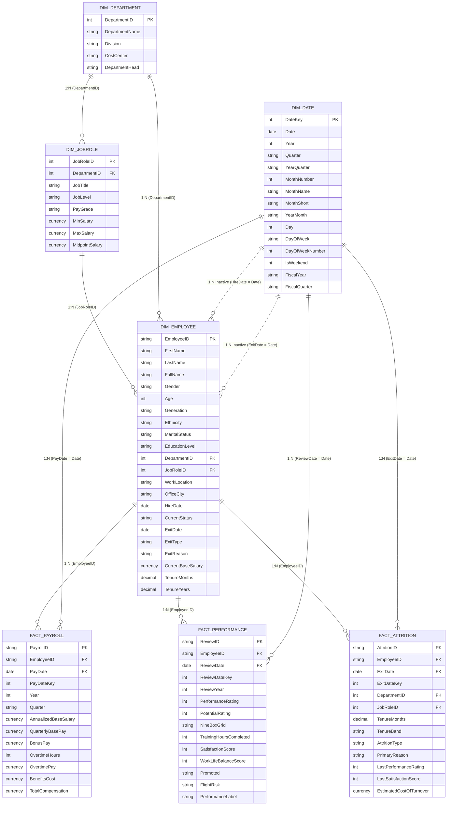

# Enterprise HR & People Analytics - Star Schema Data Model

## 1. Relational Architecture Diagram

The data model follows an enterprise Star/Snowflake hybrid architecture optimized for DAX performance, storage efficiency (VertiPaq compression), and intuitive self-service report authoring.

---

## 2. Relationship Specifications

| From Table | From Column | To Table | To Column | Cardinality | Cross Filter | State | Description |
| :--- | :--- | :--- | :--- | :--- | :--- | :--- | :--- |
| `Dim_Department` | `DepartmentID` | `Dim_JobRole` | `DepartmentID` | 1 to Many (`1:*`) | Single | Active | Department to Roles |
| `Dim_Department` | `DepartmentID` | `Dim_Employee` | `DepartmentID` | 1 to Many (`1:*`) | Single | Active | Department direct slicing |
| `Dim_JobRole` | `JobRoleID` | `Dim_Employee` | `JobRoleID` | 1 to Many (`1:*`) | Single | Active | Job hierarchy & titles |
| `Dim_Employee` | `EmployeeID` | `Fact_Payroll` | `EmployeeID` | 1 to Many (`1:*`) | Single | Active | Employee compensation |
| `Dim_Employee` | `EmployeeID` | `Fact_Performance`| `EmployeeID` | 1 to Many (`1:*`) | Single | Active | Employee appraisals |
| `Dim_Employee` | `EmployeeID` | `Fact_Attrition` | `EmployeeID` | 1 to Many (`1:*`) | Single | Active | Terminated staff history |
| `Dim_Date` | `Date` | `Fact_Payroll` | `PayDate` | 1 to Many (`1:*`) | Single | Active | Pay date calendar |
| `Dim_Date` | `Date` | `Fact_Performance`| `ReviewDate` | 1 to Many (`1:*`) | Single | Active | Performance cycle calendar |
| `Dim_Date` | `Date` | `Fact_Attrition` | `ExitDate` | 1 to Many (`1:*`) | Single | Active | Separation date calendar |
| `Dim_Date` | `Date` | `Dim_Employee` | `HireDate` | 1 to Many (`1:*`) | Single | Inactive | Activated via `USERELATIONSHIP` for New Hires |
| `Dim_Date` | `Date` | `Dim_Employee` | `ExitDate` | 1 to Many (`1:*`) | Single | Inactive | Activated via `USERELATIONSHIP` for Terminations |

---

## 3. Power BI Modeling Best Practices Applied

1. **Mark as Date Table**:
   - `Dim_Date` is flagged as an official Date Table on the `Date` column, disabling automatic internal date hierarchies to minimize memory overhead.
2. **Sort By Column**:
   - `MonthName` sorted by `MonthNumber`.
   - `MonthShort` sorted by `MonthNumber`.
   - `DayOfWeek` sorted by `DayOfWeekNumber`.
   - `JobLevel` sorted custom index (Entry -> Mid -> Senior -> Lead/Manager -> Executive).
   - `NineBoxGrid` grouped into meaningful potential/performance quadrants.
3. **Column Visibility**:
   - Technical surrogate keys and foreign keys in Fact tables (e.g. `PayDateKey`, `ReviewDateKey`) are hidden from Report View to keep the field list clean.
4. **Formatting Rules**:
   - Financial figures: Currency `$#,##0`
   - Percentages: `0.0%`
   - Ratings: Decimal `0.00`
